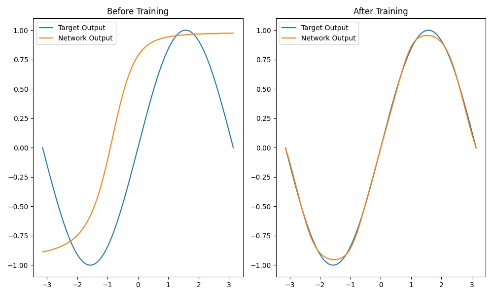
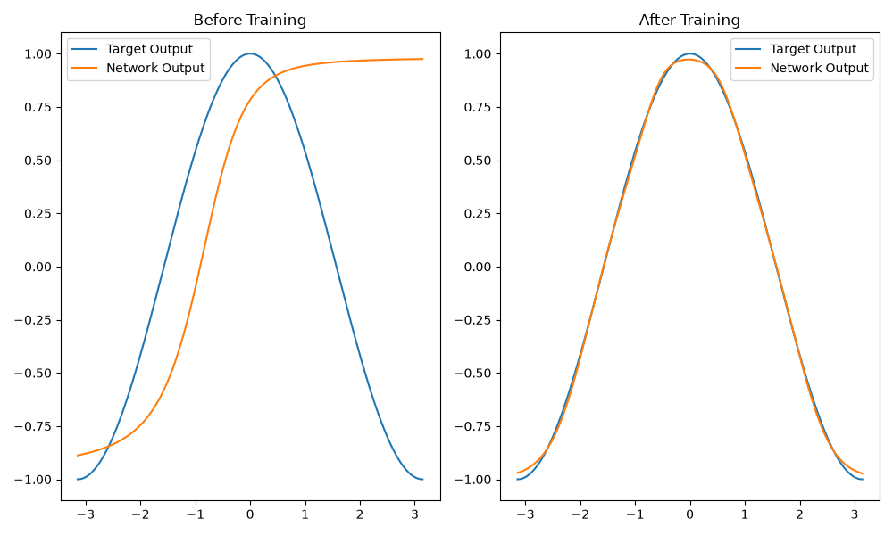
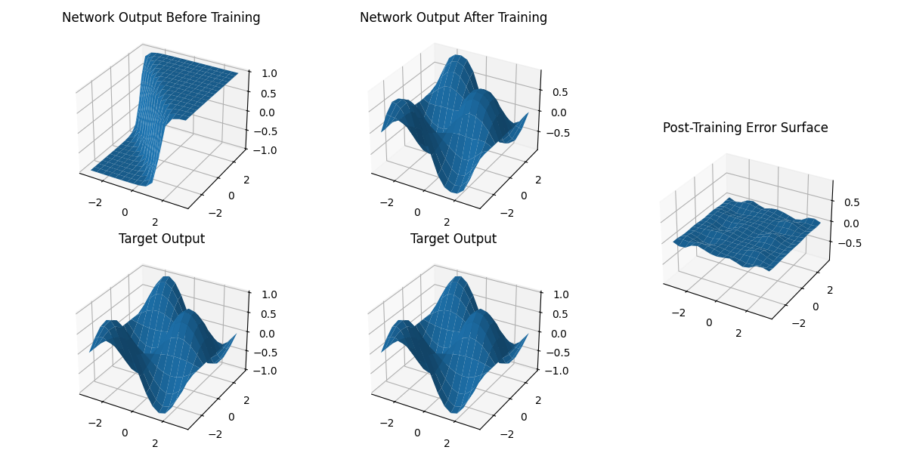

# Neural Network from Scratch

A compact, educational neural network implementation built only with NumPy. This project demonstrates how to implement a feed-forward neural network from scratch, train it with gradient descent, and fit simple mathematical functions and logical gates without relying on external ML libraries.

## Features

- Fully custom neural network implementation
- Backpropagation and gradient descent training
- Support for `sigmoid` and `tanh` activations
- Synthetic datasets for:
  - sine
  - cosine
  - sine times cosine
  - AND gate
  - OR gate
- Example training scripts for different tasks
- Visualization of predictions before and after training

## Repository Structure

```text
neural_network_from_scratch/
├── README.md
├── requirements.txt
├── setup.py
├── .gitignore
├── src/
│   ├── __init__.py
│   ├── nn_framework.py
│   └── data_generator.py
└── examples/
    ├── train_sin.py
    ├── train_cos.py
    ├── train_sincos.py
    └── train_and_gate.py
```

## Core Components

### `src/nn_framework.py`
Contains the `NN` class used for:

- initializing weights and biases
- forward propagation
- activation functions
- backpropagation gradients
- parameter updates during training

### `src/data_generator.py`
Generates example datasets for training and validation. Supported functions include:

- `sin`
- `cos`
- `sin*cos`
- `andgate`
- `orgate`

### `examples/`
Contains standalone scripts for different learning tasks, such as:

- sine regression
- cosine regression
- sine-cosine surface fitting
- AND gate learning

### `results/`
Contains the training results of the example scripts:

## sin(x)


## cos(x)


## sin(x)*cos(y)


## AND(x, y)
| x | y | Target Output | Network Output |
|------:|--------:|------:|--------:|
| 0 | 0 | 0 | 0.00250893 |
| 0 | 1 | 0 | 0.05294365 |
| 1 | 0 | 0 | 0.05297154 |
| 1 | 1 | 1 | 0.92694488 |

## Installation

Install the required dependencies:

```bash
pip install -r requirements.txt
```

## Running the Project

### Run an example script

```bash
python examples/train_sin.py
python examples/train_cos.py
python examples/train_sincos.py
python examples/train_and_gate.py
```

## Example Usage

```python
import numpy as np
from src.nn_framework import NN
from src.data_generator import generator

# Generate sine data
X, y = generator.generate('sin', 64)

# Build network
nn = NN([1, 16, 1], 'tanh')

# Train
for _ in range(3000):
    nn.train(X, y, learning_rate=0.05, batch_size=1)

# Predict
pred = nn.forward_pass(X, is_training=False)
print(pred[:5])
```

## Notes

This project is intentionally simple and designed for learning. It is ideal for understanding:

- how neural networks are structured
- how forward and backward passes work
- how training data is prepared
- how activation functions affect learning
- how gradient descent updates model parameters

## License

This project is provided for educational and experimental use.
